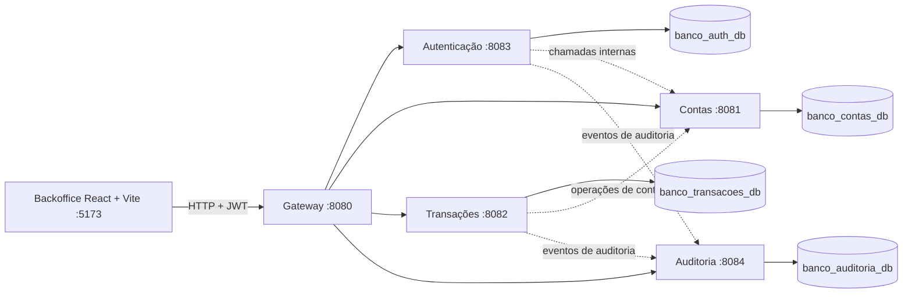

# Banco Digital

Sistema bancário distribuído com serviços Spring Boot, API REST e backoffice web para operações de funcionários. O projeto é composto por cinco serviços independentes, cada um com responsabilidade e banco de dados próprios.

## Funcionalidades

- Autenticação de clientes e funcionários com JWT.
- Backoffice para consultar o painel, pesquisar clientes e contas, abrir contas, registrar depósitos, imprimir comprovantes e consultar extratos e auditoria.
- Cadastro e listagem de funcionários pelo Admin principal.
- Bloqueio e desbloqueio de contas.
- Transferências entre contas de clientes pela API.
- Auditoria best-effort das operações.
- Testes de concorrência para depósitos e transferências.

O backoffice usa a API existente e não cria dados fictícios ou de demonstração.

## Arquitetura



| Serviço | Responsabilidade | Porta padrão | Banco padrão |
|---|---|---:|---|
| Gateway | Roteamento HTTP, validação inicial de JWT e CORS | 8080 | Não possui |
| Contas | Clientes, contas, saldos e PINs | 8081 | `banco_contas_db` |
| Transações | Depósitos, transferências e movimentos | 8082 | `banco_transacoes_db` |
| Autenticação | Login, funcionários e emissão de JWT | 8083 | `banco_auth_db` |
| Auditoria | Histórico de eventos | 8084 | `banco_auditoria_db` |

As chamadas entre serviços usam `X-Internal-Key`. Rotas `/internal/**` não são expostas pelo gateway. Cada serviço valida novamente o JWT e as permissões pertinentes.

## Tecnologias e requisitos

- Java 24 para Contas, Transações, Autenticação e Auditoria.
- Java 21 para o Gateway.
- MySQL disponível em `localhost:3306` para execução local.
- Node.js 20 ou superior e npm para o backoffice.
- Visual Studio Code com as extensões Java é opcional, mas permite iniciar todos os serviços pelo compound já configurado.

O MySQL precisa aceitar a criação dos bancos configurados ou eles devem ser criados previamente. O Hibernate atualiza o esquema com `ddl-auto=update`; não há migrações versionadas.

## Configuração local

### Backend

O VS Code carrega as variáveis de `microserviços/.env.local`. Crie esse arquivo a partir do exemplo somente se ele ainda não existir:

```powershell
if (-not (Test-Path 'microserviços/.env.local')) {
  Copy-Item 'microserviços/.env.example' 'microserviços/.env.local'
}
```

Configure os valores locais no arquivo, sem incluí-los no Git ou em mensagens compartilhadas:

| Variável | Uso |
|---|---|
| `DB_USER`, `DB_PASSWORD` | Credenciais do MySQL |
| `ADMIN_PASSWORD` | Senha inicial do Admin, necessária somente quando a base de autenticação ainda não tem funcionários |
| `ADMIN_EMAIL` | E-mail do Admin principal; padrão `admin@banco.mz` |
| `JWT_SECRET` | Chave de assinatura dos tokens |
| `INTERNAL_API_KEY` | Chave de autenticação entre serviços |
| `BANCO_NOME` | Nome do banco devolvido pela API |
| `PORT`, `DB_URL`, `*_URL` | Sobrescritas opcionais de porta, banco ou endereço de serviço |

Não defina `DB_URL` no arquivo compartilhado de ambiente: cada serviço tem uma URL de banco padrão distinta. O seed do Admin só é executado quando a tabela de funcionários está vazia; se já houver registros, alterar `ADMIN_PASSWORD` não troca a senha existente.

### Backoffice

```powershell
Set-Location backoffice
Copy-Item .env.example .env
npm install
npm run dev
```

Abra o endereço indicado pelo Vite, normalmente `http://localhost:5173`.

| Variável | Padrão | Descrição |
|---|---|---|
| `VITE_API_URL` | `http://localhost:8080` | URL base do Gateway |
| `VITE_BANCO_NOME` | `Banco ISCIM` | Nome exibido na interface e nos documentos |

O Gateway permite CORS para as origens locais `http://localhost:5173` e `http://localhost:3000`.

## Iniciar todos os serviços

1. Inicie o MySQL e configure `microserviços/.env.local`.
2. No VS Code, abra **Run and Debug** e execute **Banco Digital (todos os serviços)**. A configuração `.vscode/launch.json` compila e inicia Auditoria, Contas, Transações, Autenticação e Gateway. Os logs aparecem nos terminais de depuração.
3. Inicie o backoffice conforme a seção anterior.

Também é possível iniciar cada serviço em um terminal separado, a partir da raiz do projeto:

```powershell
Set-Location 'microserviços/auditoria'; .\mvnw.cmd spring-boot:run
```

```powershell
Set-Location 'microserviços/contas'; .\mvnw.cmd spring-boot:run
```

```powershell
Set-Location 'microserviços/transaccoes'; .\mvnw.cmd spring-boot:run
```

```powershell
Set-Location 'microserviços/autenticacao'; .\mvnw.cmd spring-boot:run
```

```powershell
Set-Location 'microserviços/gateway'; .\mvnw.cmd spring-boot:run
```

Mantenha cada processo em seu próprio terminal. Configure as mesmas variáveis de ambiente em cada processo; para iniciá-los pelo VS Code, use o `envFile` configurado nos launch configurations.

## Acesso e funcionários

O Admin principal é identificado pelo e-mail `ADMIN_EMAIL` e recebe `ROLE_ADMIN` ao entrar. Ele também pode executar operações disponíveis a funcionários. Na página **Funcionários**, pode cadastrar e listar funcionários; as senhas são armazenadas com BCrypt e nunca aparecem na resposta da listagem. Os demais funcionários recebem `ROLE_FUNCIONARIO` e não podem administrar funcionários.

O login do backoffice usa `POST /auth/login/funcionario`. Depois de mudanças na configuração ou no papel do Admin, encerre a sessão no backoffice e entre novamente para obter um JWT atualizado.

## API

O Gateway atende em `http://localhost:8080`. Exceto login e preflight CORS, as rotas públicas exigem `Authorization: Bearer <token>`.

| Área | Rotas principais |
|---|---|
| Funcionários | `POST /auth/login/funcionario`, `GET /auth/funcionarios`, `POST /auth/funcionarios` (Admin principal) |
| Clientes | `GET/POST /clientes`, `GET/PUT /clientes/{id}` |
| Contas | `GET /contas`, `GET /contas/{numero}`, `POST /clientes/{id}/contas`, bloqueio/desbloqueio |
| Depósitos e movimentos | `POST /contas/{numero}/depositos`, `GET /contas/{numero}/movimentos` |
| Transferências | `POST /transferencias` (cliente autenticado) |
| Auditoria | `GET /auditoria` com filtros e paginação documentados |

Veja o contrato completo, formatos de requisição/resposta, códigos HTTP e regras de autorização em [docs/API.md](docs/API.md). A coleção para testes manuais está em [docs/postman/banco.postman_collection.json](docs/postman/banco.postman_collection.json).

## Testes e build

### Backoffice

Execute em `backoffice/`:

```powershell
npm test
npm run build
```

Os testes usam o `node:test` integrado ao Node.js.

### Serviços Java

Execute em cada pasta de serviço:

```powershell
.\mvnw.cmd test
```

Exemplo a partir da raiz:

```powershell
Set-Location 'microserviços/autenticacao'; .\mvnw.cmd test
```

Alguns testes de contexto usam o MySQL local configurado para o serviço. Os testes de concorrência de Contas usam H2 isolado; veja [docs/TESTES_CONCORRENCIA.md](docs/TESTES_CONCORRENCIA.md).

No VS Code, a task **Java Debug: Maven Compile** compila sequencialmente os cinco módulos sem executar testes.

## Estrutura do repositório

```text
.
├── .vscode/                 # Launch configurations e tasks Java
├── backoffice/              # Aplicação React + Vite
├── docs/                    # Contrato da API, arquitetura e testes
└── microserviços/
    ├── gateway/
    ├── contas/
    ├── transaccoes/
    ├── autenticacao/
    └── auditoria/
```

## Documentação relacionada

- [Arquitetura](docs/ARQUITECTURA.md)
- [Contrato da API](docs/API.md)
- [Testes de concorrência](docs/TESTES_CONCORRENCIA.md)
- [README do backoffice](backoffice/README.md)

## Limitações conhecidas

- Os serviços usam bancos separados e não há transação distribuída para transferências. Uma interrupção entre atualizar saldos e concluir o registro da transação pode exigir reconciliação; a análise está em [docs/ARQUITECTURA.md](docs/ARQUITECTURA.md).
- O esquema é gerenciado por `ddl-auto=update`, sem migrações versionadas.
- Os valores secretos padrão presentes em `application.properties` são exclusivamente para desenvolvimento local e não devem ser usados em produção. Configure segredos fortes por variáveis de ambiente antes de expor qualquer serviço.
- O serviço de Auditoria é best-effort: falhas de auditoria são registradas, mas não interrompem a operação principal.
