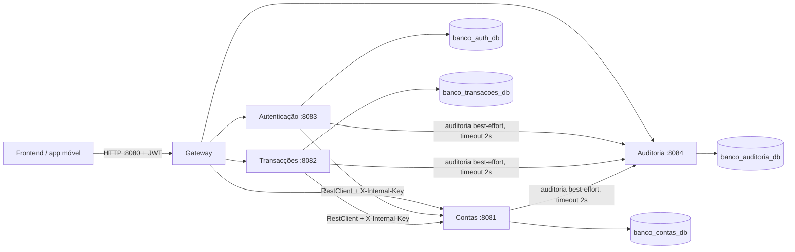

# Arquitectura do banco digital

## Componentes

O gateway valida JWT, encaminha as rotas e não expõe `/internal/**`. Os serviços validam novamente a assinatura JWT e os papéis. As chamadas internas para Contas e Auditoria usam `X-Internal-Key`, configurada em todos os serviços como `INTERNAL_API_KEY`. As chaves e palavras-passe de produção devem ser definidas por variáveis de ambiente; os valores por omissão são apenas para desenvolvimento local.

## Dados por serviço

- **Contas:** `Cliente(id, nome, numeroBi, telefone, email, estado)`; `Conta(id, numero, cliente, pinHash, saldo, estado, dataAbertura, primeiroAcesso, version)`. O número de BI e o número da conta são únicos.
- **Autenticação:** `Funcionario(id, nome, email, palavraPasse, estado)`. As palavras-passe são armazenadas com BCrypt.
- **Transacções:** `Transaccao(id, referencia, contaOrigem, contaDestino, valor, dataHora, tipo, estado, motivo, registadoPor)`. Os valores são `BigDecimal` persistidos à escala 2.
- **Auditoria:** `Auditoria(id, dataHora, tipoAtor, ator, accao, detalhe)`. A data/hora é atribuída no serviço e o detalhe tem limite de 500 caracteres.
- **Gateway:** não possui base de dados.

Cada serviço usa a sua própria base MySQL. O esquema é actualizado com `spring.jpa.hibernate.ddl-auto=update`; não há migrações versionadas.

## Transferências e concorrência

1. Transacções grava uma entrada `PENDENTE`.
2. Contas valida as contas, estado, PIN e primeiro acesso, e executa a transferência numa transacção local.
3. Contas bloqueia pessimisticamente primeiro o número de conta menor e depois o maior; esta ordem deve ser preservada para reduzir deadlocks. `@Version` é mantido como protecção adicional contra actualizações concorrentes.
4. Transacções marca a entrada como `CONCLUIDA` ou `FALHADA`. Não se envolve o fluxo completo numa transacção JPA de Transacções, para preservar o registo de falhas.

**Limitação:** existe uma janela entre Contas alterar os saldos e Transacções marcar a operação como concluída. Uma queda nessa janela pode deixar um registo pendente apesar da transferência ter ocorrido. Num sistema real seria necessário idempotência e um processo de reconciliação/outbox.

## Suposições desta implementação

- O anexo pede Java 24 em Contas, Transacções, Autenticação e Auditoria, e Java 21 / Spring Boot 3.3.3 no Gateway. As versões dos quatro módulos existentes foram mantidas, apesar do pedido anterior de upgrade do runtime.
- O `ADMIN_PASSWORD` é obrigatório quando a tabela de funcionários está vazia; a aplicação falha explicitamente sem ele em vez de criar uma credencial padrão conhecida. O administrador inicial usa o email de `ADMIN_EMAIL`.
- O valor substituto `[NOME_DO_BANCO]` deve ser ajustado com `BANCO_NOME`.
- A auditoria é best-effort: os clientes usam timeouts de ligação/leitura de 2 segundos e registam falhas no log sem interromper a operação principal.
- A identidade autenticada é passada pelo controller ao serviço de negócio; não se lê o `SecurityContextHolder` dentro do serviço de Transacções.
- O repositório de trabalho não contém `.git`; por isso não foi possível retirar ficheiros já indexados nem criar um commit.

## Configuração local

Defina pelo menos `JWT_SECRET`, `INTERNAL_API_KEY`, `DB_PASSWORD` quando necessário e `ADMIN_PASSWORD` antes de iniciar os serviços. `DB_URL`, `DB_USER`, `CONTAS_URL`, `AUDITORIA_URL`, `AUTH_URL`, `TRANSACOES_URL` e `BANCO_NOME` permitem substituir os valores locais.
